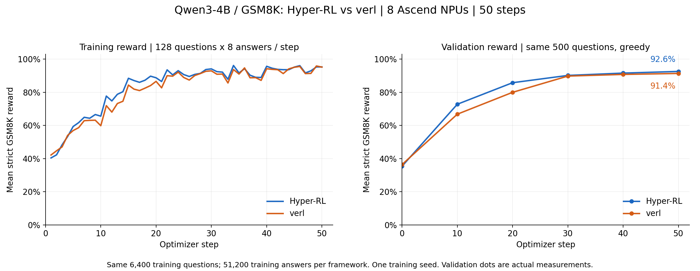

# 性能与精度优化跟踪

本台账记录 Qwen3-4B、GSM8K、8×910B3、每步128题×8回答的优化状态。
训练 FSDP/HSDP DP8/TP1，rollout TP2/DP4。不同镜像版本、随机回答长度和计时边界必须随结果披露。
新一轮记录修改、所复用组件、性能/显存/利用率、数值检查、证据和状态；不将各阶段收益相加当总收益。

## 已完成

| 项目 | 修改与复用 | 实测结果 | 边界 |
| --- | --- | --- | --- |
| 引擎级 RNG | 可省略逐轨迹 seed，复用 vLLM 批量随机采样 | 3487.1→3901.1 token/s | 同调用顺序的复现不等于跨调度复现 |
| 概率返回与 HTTP | 保留概率开关，性能配方关闭；请求批量化 | 响应体约49.5→7 MiB；吞吐没有稳定收益 | old 锚点仍由 Actor 重算 |
| 推理统计 | 关闭逐 token 服务统计，保留训练日志 | 3884.2→4304.6 token/s | 不再有相关服务端阶段统计 |
| 推理队列 | 子进程 `TASK_QUEUE_ENABLE=2` | 4304.6→5416.8 token/s | 主要降低主机调用开销 |
| Actor/优化器常驻 | 复用 HSDP offload policy；Reference 可单独 offload | 同轨迹 Actor 90.400→46.417秒，降低48.65% | 增加设备显存；offload功能保留 |
| Zero-copy与末尾归约 | 复用共享 HSDP flat buffer和梯度同步 | 46.417→45.741→43.103秒 | 后者分配峰值约10.659→23.840 GiB |
| Actor动态分批 | 共享 FirstFitPackingSelector、长度排序、裁剪、DP次数对齐 | 固定42.726→动态4096预算36.522秒，降低14.52% | 矩形输入，非 remove-padding；分配峰值23.840→26.985 GiB |
| 发布后缓存释放 | 复用状态释放边界，不释放在用参数 | 完整通过轮整卡采样峰值约58.58 GiB | 用于显存余量，不算计算提速 |
| 采样生命周期 | 等待流后记录 q 的使用流 | 原生RL verl非法/非有限token 5765→0 | 修复已接受；没有单独测量性能开销 |

推理组合相对原始对照：3487.1→5416.8 token/s，吞吐提高55.34%，耗时降低35.15%。
同协议 verl 运行时5423.5 token/s，差-0.125%；这不是两个完整 RL 入口的速度比。
逐项结果见 [推理 CSV](results/rollout_performance.csv)、[驻留回放 CSV](results/residency_replay.csv)。

训练侧仍使用共享模型、优化器、HSDP和激活重计算，没有另写一套训练引擎。
动态分组存在超出固定重复波动的 BF16/累积顺序差异，不宣称逐位等价。

## 历史50步验收：修复采样器之前

相同6400道训练题、51200条训练回答；相同500题在0/10/20/30/40/50步greedy验证。

| 指标 | Hyper-RL | verl |
| --- | --- | --- |
| 纯训练平均秒/步 | 180.740 | 180.238 |
| 最终严格验证reward | 92.6% | 91.4% |
| old log-prob秒/步 | 9.938 | 7.940 |
| Reference秒/步 | 14.065 | 6.395 |
| Actor更新秒/步 | 25.671 | 23.874 |
| 发布及推理恢复秒/步 | 2.004 | 5.377 |

整步耗时差0.28%；最终reward差的逐题配对bootstrap 95%区间[-0.4,+2.8]个百分点，
是单训练seed证据，不证明显著优越或多seed非劣性。Hyper生成token总数少5.88%，不能将生成时间优势全部归因于实现。

原始汇总：[训练CSV](results/training_50_steps.csv)、[验证CSV](results/accuracy_50_steps.csv)。
这些结果不代表采样修复后的50步精度验收。

## 采样修复与reward归因

独立严格one-hot：Hyper/verl原版各12/49152、11/49152次误选，修复及同流参考均0；
另有分布频率、batch边界、4个seed及generator映射检查。
原生两步诊断 MAE：Hyper 0.017642→0.011166，verl 0.063519→0.010352；
RMS分别0.300750→0.040401、1.014133→0.037623。仍有少量有限尾部误差，尚未完全归因。
证据：[修复对照](results/sampler_repair_comparison.json)。

24项固定权重实验完成：两环境×三种子×原版/修复×1024/2048上限，每项256题×8回答。

| 环境/上限 | 原版均值 | 修复均值 |
| --- | --- | --- |
| Hyper 1024 | 40.27% | 38.87% |
| Hyper 2048 | 50.72% | 49.61% |
| verl 1024 | 41.18% | 39.24% |
| verl 2048 | 51.24% | 51.14% |

上限延长提升约10—12个百分点，截断比例约38—39%降至11—12%；verl前后差距明显缩小，Hyper只小幅缩小。
“错误采样让原回复提前结束、修复后超预算”是可能机制，尚未直接证明为主要原因。
三个seed的修复差值区间均跨0，不证明稳定退化，也不证明无损。
原版Hyper/verl各出现4/2个词表外token，修复后均0，修复样本约2266万回答token。
HTTP传输概率可能夹紧非有限值，不能替代原生概率检查。

本轮独立短训练只有Hyper seed17原版完成：两步验证35.2%→44.0%，不是修复版的验证结果。
其余11项按用户决定停止；已有证据支持接受生命周期修复，不追加本轮reward归因训练。
[归因汇总](results/sampler_reward_attribution.json)仅包含审核完成的24项固定权重结果。

## 后续状态

| 优先级 | 工作 | 状态/下一步 |
| --- | --- | --- |
| 0 | 固化采样修复 | 新实验容器启动时按SHA核对并应用；原发布镜像本身未重建 |
| 1 | old/ref动态分批 | 代码和CPU检查完成；基线受外部占卡中断，动态组未运行，无有效NPU收益结果 |
| 2 | DP token均衡 | 尚未实施；Hyper最忙rank/均值约1.1323，不能视为时间收益比例 |
| 3 | 输出头/selected log-prob | 尚未隔离测量；优先复用既有模型实现 |
| 4 | 去padding、attention路径 | 尚未实施；先profile并检查数值语义 |
| 5 | 残余训推概率差异 | 尚未隔离TP、BF16和KV增量路径；不阻塞已接受的生命周期修复 |

下一轮只做[old/ref两组各一步](README.md#oldreference-动态分批两组各一步)，预算均4096。
保持Actor配置和Reference offload，关闭推理概率返回，不增加额外NPU消融。
同时考察阶段耗时、token工作量、allocated/reserved、整卡HBM余量、逐卡AICore利用率和外部争用。
可复用工具已整理，远端NPU验收尚未执行；本地旧队列保持暂停。

## 本次整理的检查记录

相关 CPU 回归256项通过，覆盖策略、动态分批、配置、Qwen3适配、编排、推理运行时、监控及便携实验工具。
Markdown、相对文档路径、AGENTS目录、Shell语法和差异空白检查通过。
生产代码及新工具单独运行 pylint 通过，检查中仅停用与当前 Torch-only 规则冲突的旧 `forbidden-backend-import` 项。
AutoGit 总检查未全绿：仍报告旧后端限制、CPU UT硬件标记要求，以及已有测试辅助函数文档和复杂度问题；
这些问题未通过改动主项目门禁规则来隐藏。本次为实验分支提交，没有创建或合并PR，没有重新运行NPU实验。
